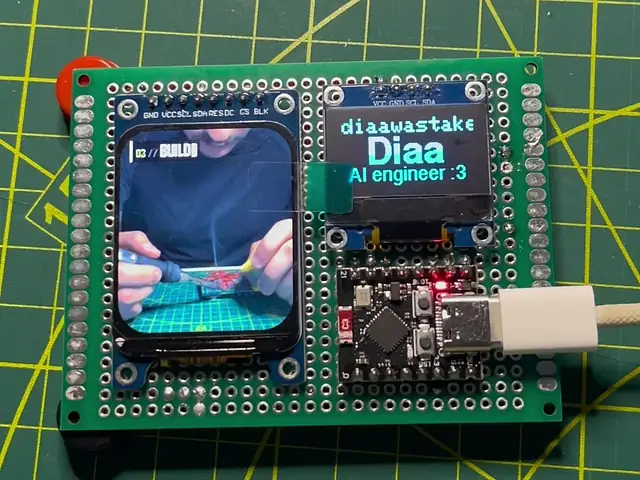
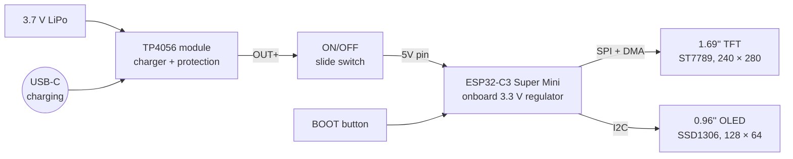
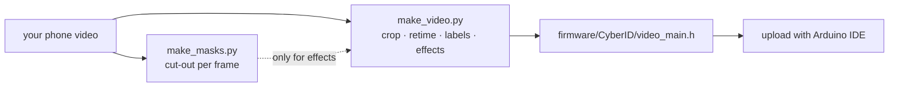
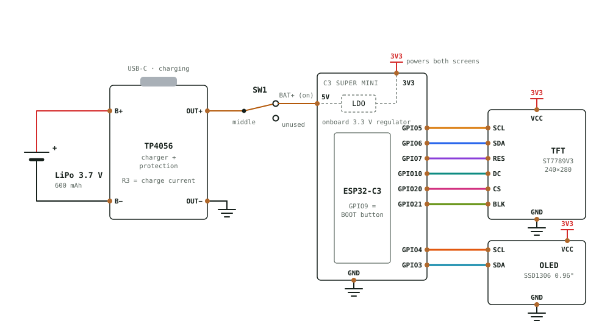
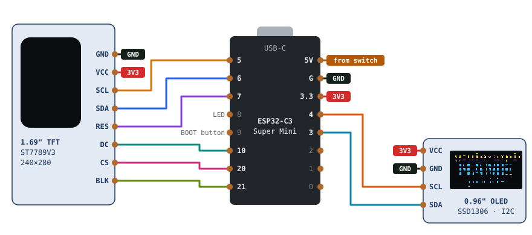
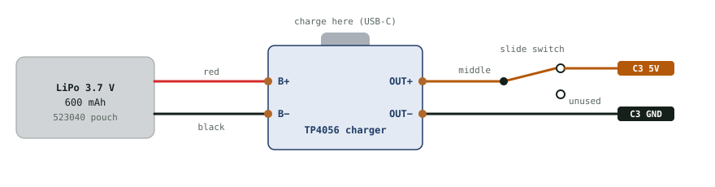
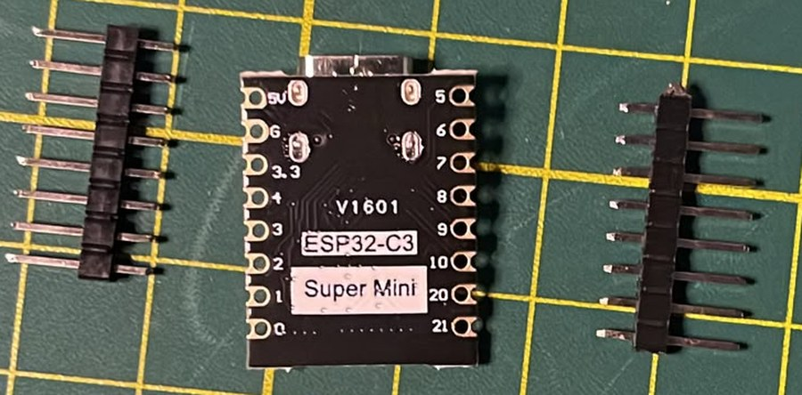
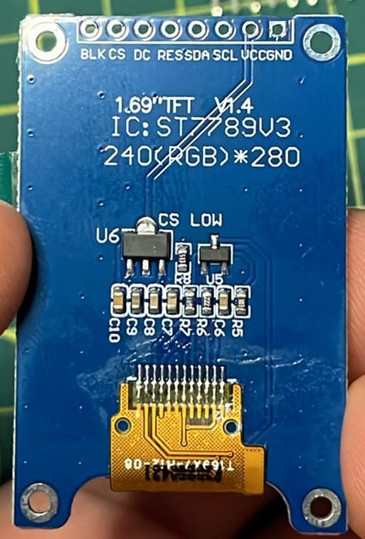
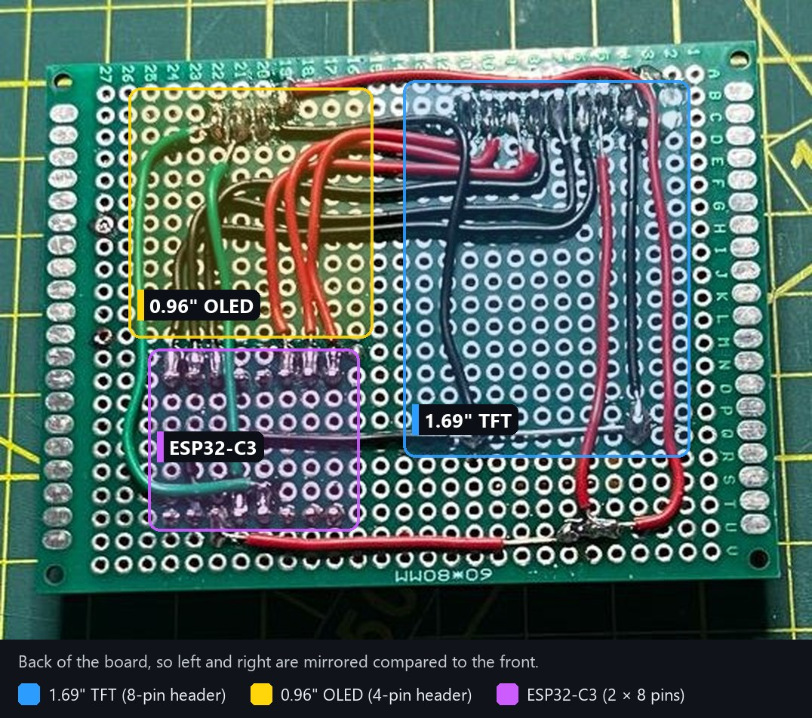

# Cyber ID Card 🪪

**An ID card that plays a video of you.** A 1.69" color screen loops a short clip of you, and a small OLED shows your name with your email or handle scrolling along the top. It runs on an ESP32-C3 Super Mini and a rechargeable LiPo, all on one perfboard.
The clip comes with built-in effects: scene labels that type themselves in (`01 // TRAIN`), and a word that flows around you like a halo.

<!-- TODO: add photos of the finished card (images/card_front.jpg, images/card_back.jpg) -->
<p align="center">
  
  <br>
  <sub>The finished card: the TFT loops the clip, the OLED shows the name tag with the email scrolling along the top</sub>
</p>

---

## Table of contents

- [What's in this repo](#whats-in-this-repo)
- [How it works](#how-it-works)
- [Parts list](#parts-list)
- [Tools](#tools)
- [Board layout](#board-layout)
- [Reference diagrams](#reference-diagrams)
- [Wiring tables](#wiring-tables)
- [Build steps](#build-steps)
- [Programming the C3](#programming-the-c3)
- [Make it yours](#make-it-yours) (with [Claude Code](#let-claude-code-help))
- [Settings you can change](#settings-you-can-change)
- [Tips so you don't mess it up](#tips-so-you-dont-mess-it-up)
- [Troubleshooting](#troubleshooting)
- [Credits](#credits)
- [License](#license)

---

## What's in this repo

| File | What it is |
| --- | --- |
| [`firmware/CyberID/CyberID.ino`](firmware/CyberID/CyberID.ino) | Arduino sketch: video player, OLED name tag, BOOT button |
| [`firmware/CyberID/video_main.h`](firmware/CyberID/video_main.h) | The clip, converted to JPEG frames in a C array. **Placeholder**, replace it with your own |
| [`tools/make_video.py`](tools/make_video.py) | Turns a phone video into that header: crop, timing, labels, effects |
| [`tools/make_masks.py`](tools/make_masks.py) | Cuts you out of every frame (needed for the flowing-text and outline effects) |
| [`videos/placeholder.mp4`](videos/placeholder.mp4) | The source of the placeholder clip |
| [`schematic/cyber_id_card.pdf`](schematic/cyber_id_card.pdf), [`.svg`](schematic/cyber_id_card.svg) | Full schematic |
| [`images/`](images/) | Wiring diagrams, OLED layout and reference photos used below |
| [`CLAUDE.md`](CLAUDE.md), [`.claude/skills/`](.claude/skills/) | Guidance for [Claude Code](https://claude.com/claude-code), so it can walk you through adding your video and editing the code ([see below](#let-claude-code-help)) |
| `LICENSE-*` | Licenses (see [License](#license)) |

---

## How it works



- The **TP4056** charges the LiPo over USB-C and protects it from over-charge, over-discharge and shorts.
- The **slide switch** connects the charger's output to the C3's **5V pin**. The C3's own regulator makes 3.3 V for itself and both screens.
- The clip lives in the C3's **flash** as a stack of JPEG pictures. The C3 decodes them one after another and sends each block to the TFT with **DMA**, so the next block decodes while the last one is still going out. That gives a steady **16 fps** (measured).
- The **OLED** shows your name and title, with your email or handle scrolling along the top strip in a background task.
- The **BOOT button** (already on the C3) switches between clips if you add more than one. The card remembers your choice.

And on your PC, before flashing:



---

## Parts list

| Qty | Part | Notes |
| :-: | --- | --- |
| 1 | ESP32-C3 **Super Mini** | The tiny one with USB-C. Pin labels are printed on the **back** ([see below](#esp32-c3-super-mini-labels-are-on-the-back)) |
| 1 | 1.69" IPS TFT, **ST7789**, 240 × 280 | 8-pin header: `GND VCC SCL SDA RES DC CS BLK`. Works on 3.3 V |
| 1 | 0.96" OLED, **SSD1306**, 128 × 64, I2C | 4-pin header: `VCC GND SCL SDA`. Yellow/blue modules give a yellow top strip; single-color ones work the same, just in one color |
| 1 | TP4056 charger module **with protection** | The one with **6 pads** (IN+/IN−, B+/B−, **OUT+/OUT−**). The 4-pad version has no battery protection. **Read the [charging tip](#power-and-battery)** |
| 1 | 3.7 V single-cell LiPo | The card uses a 600 mAh pouch (5 × 30 × 40 mm), which sits behind the TFT |
| 1 | Small SPDT slide switch | On/off |
| 1 | 60 × 80 mm double-sided perfboard | Everything fits on one board |
| — | Pin headers | Usually included with the screens and the C3 |
| — | Wire | 22 AWG works; thinner solid-core wire is easier on a perfboard |

## Tools

- Soldering iron + solder
- **Multimeter**: for the [CS check](#4-check-the-tfts-cs-pin), the [continuity checks](#9-check-for-shorts-before-the-first-power-up) and checking the charger's R3. Don't skip it.
- Flush cutters and wire strippers
- Tweezers
- Kapton or electrical tape, and double-sided foam tape for the battery
- A fine marker
- For changing the clip: a PC with [Python 3.10+](https://www.python.org/) and [ffmpeg](https://ffmpeg.org/download.html)

---

## Board layout

This is how the card is laid out:

**Front**
- The **TFT** on the left, standing upright.
- The **OLED** at the top right.
- The **ESP32-C3** at the bottom right, **chip side up**, with its **USB-C port at the board edge** so you can reflash it later.

**Back**
- All the wiring.
- The **TP4056** charger with **its USB-C port at an edge**, the **LiPo** behind the TFT, and the **slide switch** at an edge.

Card-specific tips:
- Mount the C3 **chip side up**. That keeps its **BOOT** and **RESET** buttons reachable, and BOOT is how you switch clips.
- **Protect the battery.** Trim every lead flush and put Kapton tape over the solder joints where the battery sits. A sharp joint can puncture a LiPo pouch. Then stick the battery down with double-sided foam tape.

---

## Reference diagrams

### Schematic

<p align="center"></p>

Every ground symbol is the C3's **G** pin and every red 3V3 flag is the C3's **3.3** pin. **B−** is not ground: only the battery's black wire goes there. A printable version is in [`schematic/cyber_id_card.pdf`](schematic/cyber_id_card.pdf).

### Signal wiring (C3 seen from the front)

<p align="center"></p>

The TFT pins run down the C3's left column **in the same order as the TFT header**, so none of the wires cross. GPIO 8 (onboard LED) and 9 (BOOT button) are skipped on purpose.

### Power path

<p align="center"></p>

### ESP32-C3 Super Mini: labels are on the back

<p align="center"></p>

> [!IMPORTANT]
> The pin labels are printed on the **back** of the board. Seen from the back with USB-C at the top, the left column is `5V G 3.3 4 3 2 1 0` and the right column is `5 6 7 8 9 10 20 21`.
> Once you mount the C3 **chip side up**, those labels face the perfboard and **the two columns swap sides**. The diagrams above show it from the front, chip side up.
> **Put a marker dot next to the 5V pin on the chip side before you solder it**, so you can't get it mirrored. This board prints GND as `G` and 3V3 as `3.3`.

### TFT: the "CS LOW" resistor

<p align="center"></p>

The back of the TFT has a resistor marked **CS LOW**. It should be a pull-down that lets the screen work without a CS wire, but [check it before wiring CS](#4-check-the-tfts-cs-pin). The header order on the back is mirrored too: `BLK CS DC RES SDA SCL VCC GND`, with GND on the square pad.

---

## Wiring tables

### TFT (8 pins)

| TFT pin | C3 pin | What it is |
| --- | --- | --- |
| GND | G | Ground |
| VCC | 3.3 | 3.3 V |
| SCL | 5 | SPI clock (labelled SCL, but this is SPI, not I2C) |
| SDA | 6 | SPI data |
| RES | 7 | Reset |
| DC | 10 | Data / command |
| CS | 20 | Chip select. [Check it first](#4-check-the-tfts-cs-pin) |
| BLK | 21 | Backlight, dimmable from code |

### OLED (4 pins)

| OLED pin | C3 pin |
| --- | --- |
| VCC | 3.3 |
| GND | G |
| SCL | 4 |
| SDA | 3 |

### Power section

| From | To |
| --- | --- |
| LiPo **+** (red) | TP4056 **B+** |
| LiPo **−** (black) | TP4056 **B−** |
| TP4056 **OUT+** | Slide switch **middle** pin |
| Slide switch **outer** pin (either one) | C3 **5V** |
| TP4056 **OUT−** | C3 **G** |

The other outer pin of the slide switch isn't used, and the two pads beside the TP4056's USB-C port (**IN+ / IN−**) stay empty.

Three wires end on the C3's **G** pin and two on **3.3**. Run a short bare-wire strip for each on the back of the board and connect to that, rather than cramming wires into one hole.

---

## Build steps

### 1. Test your parts and check the charger

- Check your LiPo's wire colors and polarity.

> [!CAUTION]
> TP4056 modules charge at **1 A** by default (the resistor next to the chip, usually **R3**, reads `122` = 1.2 kΩ). That's more than most small LiPos are rated for. Check yours and lower it if your battery is small. See [Power and battery](#power-and-battery).

### 2. Mark the C3

Put a marker dot next to the **5V** pin on the **chip side** of the C3 ([why](#esp32-c3-super-mini-labels-are-on-the-back)).

### 3. Solder the headers using the perfboard as a jig

Headers soldered freehand tend to tilt, and then the module won't sit flat.

1. Push the header's **long pins into the perfboard**, where the module will go.
2. Drop the module onto the short pins so it rests flat on the black plastic spacer.
3. Solder **one pin at one end**, check it from the side, and reheat to straighten if needed. Push on the plastic, not the pins: they get hot.
4. Solder the pin at the **other end**, then the rest. Flip the board and solder the long pins.

> [!TIP]
> For the **C3**, put both headers into the perfboard first, then drop the C3 onto both, so they end up perfectly parallel.
> For the **TFT**, the header is on one edge only, so prop up the far end with something about 2.5 mm tall (a spare header strip works) while you solder.

### 4. Check the TFT's CS pin

Set your multimeter to resistance and measure between the TFT's **CS** and **GND** pins:

- **A few kΩ** is normal: wire CS as listed.
- **Close to 0 Ω** means CS is hard-wired to ground. Leave the CS wire out and set `TFT_CS = -1` in the sketch. The firmware then switches to the SPI mode that works without CS.

### 5. Place the modules

Follow the [board layout](#board-layout): TFT left, OLED top right, C3 bottom right with its USB-C at the edge.

### 6. Wire the TFT, then test it

Run the 8 TFT wires from the [table](#tft-8-pins). Then plug the C3 into USB (no battery yet), [upload the sketch](#programming-the-c3), and the clip should play.

### 7. Wire the OLED, then test it

Add the 4 OLED wires and press **RESET** on the C3. No reflash needed: your name and title appear, and the top line scrolls.

This is the back of the board at this point, with both screens wired and the power section still to come. Each part's outline is shaded around its pins: **blue** for the TFT, **yellow** for the OLED, **purple** for the ESP32-C3. It's the back, so everything is mirrored compared to the front:

<p align="center"></p>

### 8. Wire the power section

Unplug USB first. Follow the [power table](#power-section):

- The battery goes to **B+ / B−**. Take power **out** from **OUT+ / OUT−**. If you take power from B+/B− you bypass the battery protection.
- TP4056 **OUT+** → **middle** pin of the slide switch → **outer** pin → C3 **5V**.
- TP4056 **OUT−** → C3 **G**.

> [!CAUTION]
> **Never connect the battery to the C3's 3.3 pin.** A full LiPo is 4.2 V and the C3 and screens are rated for about 3.6 V. The 5V pin goes through the C3's regulator; the 3.3 pin doesn't.

### 9. Check for shorts before the first power-up

On the C3, **5V**, **G** and **3.3** sit right next to each other. With the switch **off**, put your multimeter on continuity and check:

| Probe | Expected |
| --- | --- |
| 5V ↔ G | **No beep** |
| 3.3 ↔ G | **No beep** |
| 5V ↔ 3.3 | **No beep** |

Then flip the switch on. The card should boot from the battery.

### 10. Finish

Insulate the back, stick the battery down with double-sided foam tape, and do a full charge with the switch **off**.

---

## Programming the C3

1. Install the [Arduino IDE](https://www.arduino.cc/en/software).
2. Add the ESP32 boards: **File → Preferences → Additional boards manager URLs**:
   `https://espressif.github.io/arduino-esp32/package_esp32_index.json`
   Then **Tools → Board → Boards Manager**, search **esp32** (by Espressif) and install it. Tested with **3.3.11**.
3. Install the libraries from **Tools → Manage Libraries**:

   | Library | Tested version |
   | --- | --- |
   | Adafruit GFX Library | 1.12.6 |
   | Adafruit SSD1306 | 2.5.17 |
   | Adafruit ST7735 and ST7789 Library | 1.11.0 |
   | JPEGDEC (by Larry Bank) | 1.8.4 |
   | bb_spi_lcd (by Larry Bank) | 2.9.7, offered automatically with JPEGDEC |

4. Download this repo (**Code → Download ZIP**) and open `firmware/CyberID/CyberID.ino`. Keep the `.ino` inside its `CyberID` folder, because the Arduino IDE needs the folder and file names to match.
5. Set the **Tools** menu:

   | Setting | Value |
   | --- | --- |
   | Board | **Nologo ESP32C3 Super Mini** |
   | Partition Scheme | **Huge APP (3MB No OTA/1MB SPIFFS)**. The clips need it |
   | USB CDC On Boot | **Enabled** |

6. **Switch the card off** (if the battery is connected), then plug the C3 into USB and click **Upload**.
   If the port doesn't show up or the upload fails: hold **BOOT**, tap **RESET**, let go of BOOT, and upload again. Press **RESET** afterwards.

The **Serial Monitor** (115200 baud) prints a line every 5 seconds, for example `[main] 16.0 fps, slowest frame 61 ms (DMA)`.

---

## Make it yours

Every placeholder is marked `TODO`. Search the repo for it to find them all.

### Your name, title and email

At the top of [`CyberID.ino`](firmware/CyberID/CyberID.ino):

```cpp
const char *EMAIL = "you@example.com";  // scrolls along the top strip
const char *NAME  = "NAME";             // about 6 characters fit at this size
const char *TITLE = "your title";       // one short line under the name
```

<p align="center"></p>

### Your video

The firmware ships with a placeholder clip (below). **You can use any video you like.** The three scenes with TRAIN / FIGHT / BUILD labels are just how the example is set up, not a template you have to follow.

<p align="center"></p>

```bash
pip install -r tools/requirements.txt
python tools/make_video.py videos/my_clip.mp4 main
```

That replaces `firmware/CyberID/video_main.h` and writes `videos/main_preview.jpg`, a contact sheet of every frame. Check it, then upload.

- **Any shape:** vertical, horizontal or square. The screen is 6:7, so each frame is scaled to cover it and cropped to fit. `SCENE_CROP` picks where the window sits: `0.0` is the top (or left, for wide clips) and `1.0` the bottom (or right).
- **Any number of shots:** one continuous shot or many. Hard cuts are detected automatically, and each shot becomes a **scene** with its own crop, length, label and effect.
- **Length:** about 15 seconds of video fits in total, at 16 fps. Short loops of 3 to 6 seconds look best on a card.
- The tools need **ffmpeg** on your PATH.

### Effects

Each scene can have a label and one effect, set at the top of [`make_video.py`](tools/make_video.py):

- **Labels:** `01 // TRAIN`, `02 // FIGHT`, `03 // BUILD` type themselves in with a blinking cursor and a short glitch. Change the words in `LABELS`, use `None` to skip one scene's label, or `LABELS = []` for no labels at all.
- **`"orbit"`:** a word (`ORBIT_TEXT`) flows clockwise around you, with a soft glow.
- **`"sticker"`:** a white sticker outline around you.

Both effects need a cut-out of you in every frame. Make it once:

```bash
python tools/make_masks.py videos/my_clip.mp4 main
python tools/make_video.py videos/my_clip.mp4 main
```

> [!TIP]
> If one shot has you against a dark or blurry background, redo just that scene with a sharper (slower) model:
> `python tools/make_masks.py videos/my_clip.mp4 main --scene 1 --model birefnet-general-lite`.
> Close-ups where you fill the frame look better with no effect at all (`None`).

### More than one clip

Make another header (`python tools/make_video.py videos/other.mp4 alt`), then in the sketch add `#include "video_alt.h"` and list it in `VIDEOS[]`:

```cpp
const Video *VIDEOS[] = {&main_video, &alt_video};
```

The **BOOT** button then cycles through them. A 3-second clip takes about 0.5 MB of flash, so 3 to 4 clips fit.

### Let Claude Code help

This repo includes a [`CLAUDE.md`](CLAUDE.md) and three skills for [Claude Code](https://claude.com/claude-code). Open the folder in Claude Code and just ask, for example "help me put my video on the card", or run them directly:

| Skill | What it does |
| --- | --- |
| `/add-video` | Converts your clip, checks the crop and effects on the preview with you, and tunes the settings |
| `/personalize` | Puts your name, title and email on the OLED and changes the words in the video |
| `/flash-card` | Compiles, uploads and checks the frame rate over serial |

---

## Settings you can change

### Firmware ([`CyberID.ino`](firmware/CyberID/CyberID.ino))

| Setting | Default | What it does |
| --- | --- | --- |
| `TFT_ROTATION` | `2` | `0` or `2`. Switch it if the picture is upside down |
| `BACKLIGHT` | `255` | TFT brightness, 0–255. Lower saves battery |
| `TFT_CS` | `20` | Set to `-1` if your TFT's CS is hard-wired to ground ([step 4](#4-check-the-tfts-cs-pin)) |
| `TFT_USE_DMA` | `true` | `false` falls back to a simpler driver without DMA (about 14 fps). Use it if the picture looks wrong |
| `TFT_SPI_HZ` | 40 MHz | Lower to 26 MHz if you see streaks with long wires |
| `MARQUEE_STEP_MS`, `MARQUEE_STEP_PX` | 40 ms, 2 px | OLED scroll speed |

### Converter ([`make_video.py`](tools/make_video.py))

| Setting | Default | What it does |
| --- | --- | --- |
| `SCENE_CROP` | `[0.5]` | Crop position per scene: 0 = top/left, 1 = bottom/right. The last value repeats for later scenes |
| `SCENE_LENGTH` | `[None]` | Seconds per scene on the card. `None` keeps the original length; longer slows it down |
| `SCENE_EFFECT` | `["orbit", None, None]` | `"orbit"`, `"sticker"` or `None`, per scene |
| `LABELS` | `TRAIN`, `FIGHT`, `BUILD` | One label per scene. `None` skips a scene, `[]` turns labels off |
| `ORBIT_TEXT` | `"aura"` | The word that flows around you |
| `ORBIT_SPACING`, `ORBIT_SPEED` | 14 px, 7 px/frame | Gap between the words, and how fast they move |
| `FPS` | `16` | Frames per second on the card. The C3 manages about 17–18, so 16 shows every frame |
| `QUALITY` | `70` | JPEG quality. Higher is sharper, but bigger and slower to decode |
| `FONT_FILE`, `ORBIT_FONT_FILE` | Agency FB, Segoe UI | Fonts for the labels and the orbit text (Windows paths). Point them at any `.ttf` on macOS or Linux |

---

## Tips so you don't mess it up

### The big ones

- 🔌 **Switch the card off before plugging USB into the C3.** With the switch on, the USB 5V and the battery meet at the 5V pin.
- 🔋 **Lower the TP4056 charge current for small batteries.** ([details](#power-and-battery))
- 🔄 **Remember the mirror.** The C3's labels are on the back. Mark the 5V pin before soldering.
- 🧪 **Measure the TFT's CS pin before wiring it.** ([step 4](#4-check-the-tfts-cs-pin))
- ⚡ **Battery to 5V through the switch, never to 3.3.**
- 🔍 **Check 5V, G and 3.3 for shorts before the first power-up.** They're neighbors. ([step 9](#9-check-for-shorts-before-the-first-power-up))

### Power and battery

- Charge through the **TP4056's USB-C port**. The C3's USB port does **not** charge the battery.
- Charge with the switch **off**. If the card is running while charging, the TP4056 may never see the battery as full.
- The TP4056 charges at **1 A** by default, set by its R_PROG resistor (usually **R3**, `122` = 1.2 kΩ). A safe rule is to keep the charge current **at or below the battery's capacity**:

  | Battery | R_PROG | Charge current |
  | --- | --- | --- |
  | ~1000 mAh or more | 1.2 kΩ (default) | ~1 A |
  | ~600 mAh (the card's) | 2 kΩ | ~580 mA |
  | ~500 mAh | 2.4 kΩ | ~500 mA |
  | ~300 mAh | 4 kΩ | ~300 mA |

  R3 is tiny. You don't need SMD parts to change it: melt a blob of solder across it so it slides off, then solder an ordinary through-hole resistor across the two pads. To see what your module really draws, put your multimeter (10 A jack) in line with the battery's red wire while charging.
- The card switches itself off when the battery gets down to about 3.2 V, because the C3's regulator can't hold 3.3 V any lower. Recharge it then, rather than leaving it flat.
- Rough battery life on a 600 mAh cell is **6–10 hours** at full brightness. That's an estimate, not a measurement. Lower `BACKLIGHT` for more.
- When you strip or cut the battery leads, **do one wire at a time** so they never touch.

### Soldering

- Use the perfboard as a jig for the headers ([step 3](#3-solder-the-headers-using-the-perfboard-as-a-jig)).
- Tin each wire end before joining several at one point, and give every wire a gentle tug afterwards.
- Trim leads right after soldering, especially under the battery.

---

## Troubleshooting

| Problem | What to check |
| --- | --- |
| TFT stays dark | Backlight: BLK → 21 and VCC → 3.3 |
| TFT lights up but shows nothing or white | One of SCL, SDA, RES, DC or CS is off. If you left CS out, set `TFT_CS = -1` |
| Picture upside down | Switch `TFT_ROTATION` between `2` and `0` |
| Picture garbled, shifted or wrong colors | Set `TFT_USE_DMA = false` and upload again |
| Streaks or glitches in the video | Lower `TFT_SPI_HZ` to `26000000`, or shorten the SPI wires |
| TFT dim or unreliable | Move the TFT's VCC from 3.3 to the C3's 5V pin. The module has its own regulator and is rated for 3.3–5 V |
| OLED blank, Serial says `OLED not found` | SDA and SCL swapped (pins 3 and 4), or VCC/GND not connected |
| OLED is all one color, no yellow strip | You have a single-color module. The yellow strip is printed into two-color screens, so the code can't change it |
| Upload fails or no port | Hold BOOT, tap RESET, let go of BOOT, upload again. Use a USB **data** cable. Switch the card off first |
| Video slower than 16 fps | Check the Serial Monitor. Very detailed clips decode slower: try a lower `QUALITY` |
| TP4056 never shows "full" | Switch the card **off** while charging |

---

## Credits

Designed by **[@diaawastaken](https://www.instagram.com/diaawastaken/)** on Instagram. If you build one, share it and tag me for a shoutout! 🪪

Uses [JPEGDEC](https://github.com/bitbank2/JPEGDEC) and [bb_spi_lcd](https://github.com/bitbank2/bb_spi_lcd) by Larry Bank, the [Adafruit GFX / SSD1306 / ST7789](https://github.com/adafruit) libraries, and [rembg](https://github.com/danielgatis/rembg) for the cut-outs.

---

## License

Each part of the project uses the license that fits it:

| Part | License | File |
| --- | --- | --- |
| Firmware and tools ([`firmware/`](firmware/), [`tools/`](tools/)) | [MIT](https://opensource.org/license/mit) | [`LICENSE-FIRMWARE`](LICENSE-FIRMWARE) |
| Hardware design ([`schematic/`](schematic/)) | [CERN-OHL-P v2](https://ohwr.org/cern_ohl_p_v2.txt) | [`LICENSE-HARDWARE`](LICENSE-HARDWARE) |
| Docs and images (this README, [`images/`](images/), [`videos/`](videos/)) | [CC BY 4.0](https://creativecommons.org/licenses/by/4.0/) | [`LICENSE-DOCS`](LICENSE-DOCS) |

**In short:** you're free to build it, change it, share it and use it in your own projects, as long as you keep the credit to **@diaawastaken**. See each license file for the full terms.
